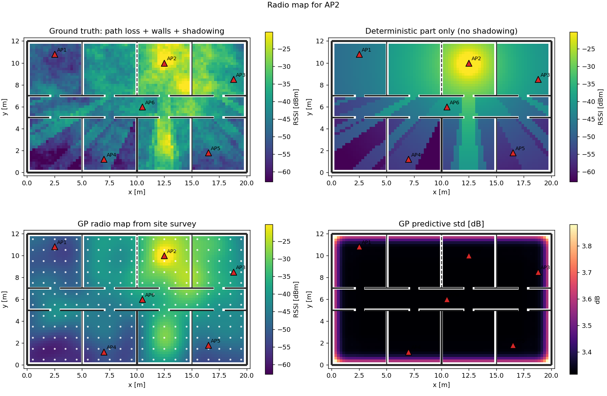
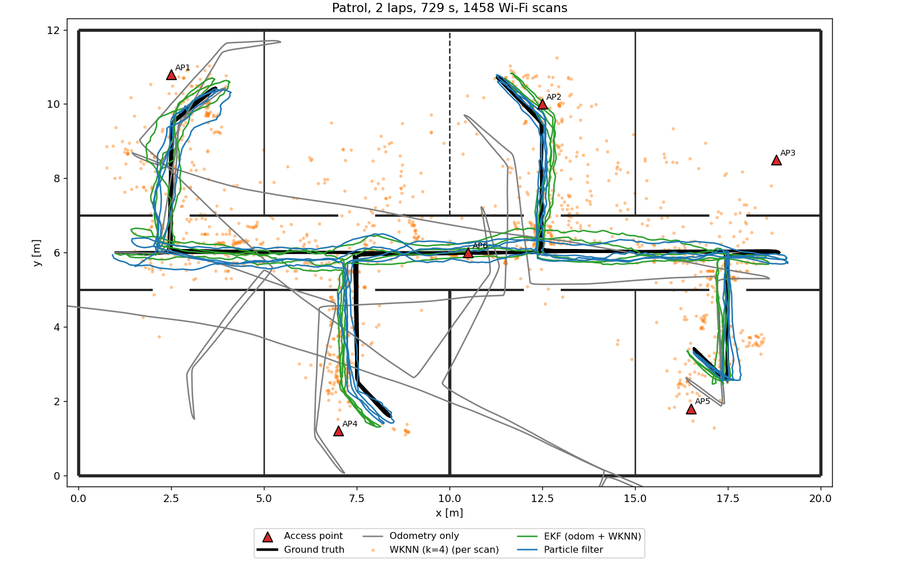
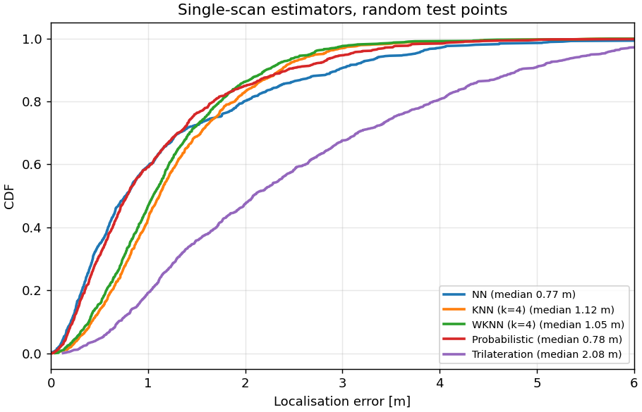
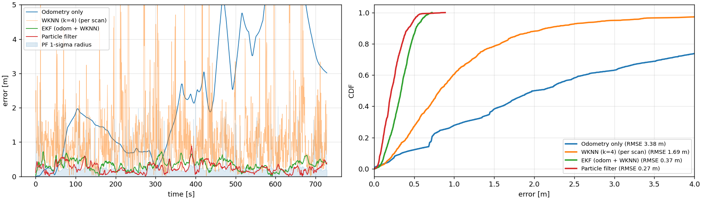
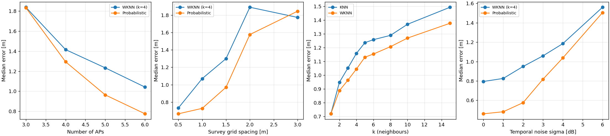
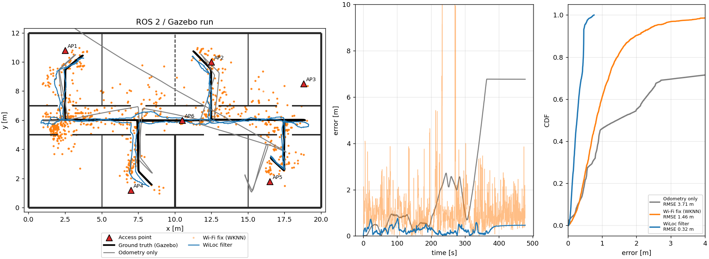

# WiLoc: Indoor Localization Using Wi-Fi RSSI Fingerprinting, a Simulation-Based Approach

WiLoc is a framework for localizing a **differential-drive robot** indoors
from Wi-Fi signal strength (RSSI). It covers the complete perception-to-
localization pipeline:

```
 floor plan (YAML) ──► radio propagation model ──► simulated site survey ──► GP radio map
        │                     (perception)               (offline phase)        (mapping)
        ▼                                                                          │
 Gazebo world + diff-drive robot ──► wheel odometry ─┐                             ▼
                               └──► Wi-Fi scans ─────┴──► particle filter / EKF ──► pose
                                                          (online phase, Bayes filtering)
```

There are two layers:

* **`wiloc/`**: a pure-Python core library with no ROS dependency, needing
  only numpy, scipy, matplotlib and pyyaml. It holds every model and
  algorithm, a fast 2-D simulator, the experiments, and the unit tests.
* **`ros2_ws/`**: ROS 2 Humble and Gazebo 11 integration. It provides a
  Gazebo world generated from the same floor plan, a diff-drive robot, a
  simulated Wi-Fi card node, an odometry-noise node, an AMCL-style
  localization node, a waypoint patrol, an online evaluator, and an RViz view.

The theory, mapped to a Perception & Localization course, is in
[`docs/theory.md`](docs/theory.md). Verified references and related repos are
in [`docs/references.md`](docs/references.md).

---

## Results (reference office, 20 m × 12 m, 6 APs, 240 fingerprints)

Reproduce with `python -m wiloc all`. The numbers below are from `results/summary.md`.

**Single-scan estimators** (1000 random test points)

| Method | median [m] | RMSE [m] | p90 [m] |
|---|---:|---:|---:|
| NN | 0.77 | 1.75 | 2.95 |
| KNN (k=4) | 1.12 | 1.56 | 2.37 |
| WKNN (k=4) | 1.05 | 1.48 | 2.21 |
| Probabilistic (Horus-style) | 0.78 | 1.51 | 2.43 |
| Trilateration (path-loss model) | 2.08 | 2.97 | 4.81 |

**Tracking a robot on a two-lap patrol** (odometry plus 2 Hz Wi-Fi)

| Method | median [m] | RMSE [m] | p90 [m] |
|---|---:|---:|---:|
| Odometry only (dead reckoning) | 2.01 | 3.38 | 6.35 |
| WKNN per scan | 0.82 | 1.69 | 2.16 |
| EKF (odometry + WKNN fixes) | 0.34 | 0.37 | 0.52 |
| **Particle filter (odometry + GP radio map)** | **0.22** | **0.27** | **0.43** |

**Other findings**

* The GP radio map has 3.3 dB RMSE against the true signal field; the
  path-loss model alone has 6.5 dB.
* With the GP map as its sensor model the particle filter reaches 0.25 m
  RMSE. With the path-loss fit it reaches 0.52 m.
* Started from a uniform prior (global localization), the particle filter
  converged in 10 of 10 runs, settling within the first scan or two.

| Radio map | Tracking |
|---|---|
|  |  |
|  |  |



The sweeps report *median* error, which favours NN: snapping onto the
nearest reference point is often exactly right. Averaging over k neighbours
(KNN, WKNN) instead trims the tail of large errors; compare the RMSE and
p90 columns in the table above. The noise sweep shows the probabilistic
estimator gaining most when scans are clean, because it also uses the
per-RP spread.

**ROS 2 / Gazebo run** (one patrol lap, particle filter):



---

## Quick start

### 1. Core library and experiments (any OS with Python 3.10+)

```bash
pip install -e .                 # or: export PYTHONPATH=$PWD
python -m pytest                 # 19 unit tests
python -m wiloc all --out results          # all experiments + figures (a few minutes)
python -m wiloc all --out results --quick  # faster, fewer samples
```

### 2. ROS 2 + Gazebo simulation (Ubuntu 22.04 / WSL2, ROS 2 Humble, Gazebo 11)

You need ROS 2 Humble with `gazebo_ros_pkgs`, `xacro`, `robot_state_publisher`
and `rviz2`.

```bash
./scripts/build_ws.sh                     # symlinks into ~/wiloc_ws and runs colcon build
source ~/wiloc_ws/install/setup.bash

ros2 launch wiloc_ros sim.launch.py                       # Gazebo GUI + RViz, particle filter
ros2 launch wiloc_ros sim.launch.py method:=ekf           # EKF instead
ros2 launch wiloc_ros sim.launch.py method:=wknn          # raw fingerprinting, no filter
ros2 launch wiloc_ros sim.launch.py global_init:=true     # unknown start pose
ros2 launch wiloc_ros sim.launch.py gui:=false rviz:=false laps:=2   # headless benchmark

# After a run, plot ground truth vs. estimate vs. Wi-Fi vs. odometry:
python3 -m wiloc plot-eval ~/.ros/wiloc_eval.csv --out results/gazebo_run.png
```

On Windows, run these inside WSL. WSLg displays the Gazebo and RViz windows.

**Using RViz during a run**

* Kidnap the robot: use **2D Pose Estimate** to give it a wrong pose and
  watch the filter recover.
* Force global re-localization:
  `ros2 service call /wiloc/global_localization std_srvs/srv/Empty`

**Launch arguments**

| Argument | Default | Meaning |
|---|---|---|
| `floorplan` | `office` | built-in name or path to a floor-plan YAML |
| `method` | `pf` | `pf`, `ekf`, or `wknn` |
| `n_particles` | 1500 | particle count |
| `global_init` | false | start with no pose prior |
| `radio_map` | *(empty)* | `.npz` from `python -m wiloc survey`; empty means survey at start-up |
| `radio_seed` | 7 | seed of the radio environment (shadowing field) |
| `scan_rate` | 2.0 | Wi-Fi scans per second |
| `odom_rot_bias`, `odom_trans_bias` | 0.04, 0.015 | odometry calibration errors |
| `laps`, `drive` | 1, true | waypoint patrol |
| `gui`, `rviz` | true, true | visualization |

---

## ROS 2 architecture

```
                 ┌──────────── Gazebo 11 (world generated from floor-plan YAML) ───────────┐
 /cmd_vel ──────►│ diff_drive plugin ── /odom (encoder)      p3d plugin ── /ground_truth   │
                 └───────────────────────────┬──────────────────────────────┬──────────────┘
                                             ▼                              │
                                      odom_noise_node                       │
                          /wheel_odom + TF odom→base_footprint              │
                                             │                              ▼
                                             │                       wifi_sensor_node
                                             │            /wifi/scan (wiloc_msgs/RssiScan)
                                             ▼                              │
                                   localization_node ◄──────────────────────┘
               /wiloc/pose  /wiloc/particles  /wiloc/wifi_fix  /wiloc/path  TF map→odom
                                             │
                    evaluator_node (vs /ground_truth) ──► /wiloc/error, CSV log
                    waypoint_driver (/ground_truth) ──► /cmd_vel
```

| Package | Contents |
|---|---|
| `wiloc` (repo root) | core library; also an `ament_python` package so ROS nodes can `import wiloc` |
| `wiloc_msgs` | `RssiScan.msg`: AP ids, RSSI in dBm (NaN means not heard), receiver sensitivity |
| `wiloc_ros` | nodes, launch file, robot xacro, RViz config, world generator |

**Design decisions**

* **The ground-truth pose drives two nodes, and nothing else.** The
  simulated Wi-Fi card uses it because RSSI depends on where the antenna
  really is. The waypoint driver uses it because it plays a human
  teleoperator. The localizer never sees it.
* **Odometry is deliberately imperfect.** Gazebo's encoder odometry is
  nearly perfect, so `odom_noise_node` adds calibration bias and random-walk
  noise. It also owns the `odom → base_footprint` TF, which keeps the TF tree
  consistent with the odometry the filter actually uses.
* **Geometry stays consistent.** Gazebo walls, radio attenuation, RViz
  markers and the particle filter's wall constraint all come from one YAML file.

---

## Repository layout

```
wiloc/                 core library
  environment.py       floor plan, walls/materials, APs, free-space queries
  radio.py             RSSI simulator (log-distance + multi-wall + Gudmundson shadowing)
  fingerprint.py       site survey, radio map (.npz), Gaussian-process dense map
  estimators.py        NN, KNN, WKNN, probabilistic, trilateration
  motion.py            diff-drive kinematics, wheel odometry, odometry motion model
  filters.py           particle filter (augmented MCL), EKF
  simulation.py        ROS-free simulator: patrol driving, scan logging, tracker replay
  experiments.py       all figures and tables
  data/office.yaml     reference floor plan
tests/                 pytest suite
ros2_ws/src/wiloc_msgs, ros2_ws/src/wiloc_ros
scripts/build_ws.sh    builds the ROS 2 workspace in ~/wiloc_ws
docs/                  theory, references, figures
```

## Extending WiLoc

* **New building.** Copy `wiloc/data/office.yaml`; edit the walls,
  materials, APs and patrol waypoints. Pass `floorplan:=/path/to/file.yaml`.
  The Gazebo world is regenerated automatically.
* **New estimator.** Subclass `wiloc.estimators.Estimator` and implement
  `predict_with_cov`. Add it to `default_estimators()` to include it in the
  benchmarks.
* **Real data.** `RadioMap` is a plain array container. Load UJIIndoorLoc or
  your own survey into `positions`, `mean`, `std` and `detect_rate`, and every
  estimator and filter works unchanged.
* **Ideas for course projects:**
  * Wi-Fi-SLAM (GP-LVM, no labelled survey).
  * Fusing a LiDAR scan-matcher with the Wi-Fi particle filter.
  * Active survey planning that uses the GP variance.
  * Device-heterogeneity offsets.

## License

MIT. See [LICENSE](LICENSE).
